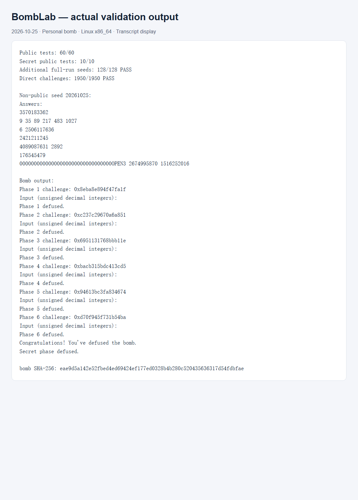

# BombLab 实验报告

验证日期：2026-10-25。环境：Windows 上的 WSL Ubuntu，Linux x86_64，GCC、GDB、GNU binutils、Python 3。

## 分析方法与工具使用声明

本报告及 `defuser.c` 由 Codex 根据本人的个人炸弹反汇编协助生成，编译、GDB 数据查看和测试也由 Codex 在本机执行。以下是对实际程序的分析及实测记录，不表示本人已经独立完成全部推导或复核；提交前应逐项理解、复核，并依据课程对 AI 使用的规定处理。本报告没有使用其他同学的代码或答案。

只实现 `defuser.c`，没有修改个人炸弹、公共接口、驱动、测试程序和工作流。GDB 仅用于读取内存中的数据表，没有修改寄存器或内存来绕过检查。解法只进行内存中的计算和 `snprintf` 格式化，不读取文件、不访问网络、不启动进程，也没有内联汇编。

使用 `nm -n bomb` 定位函数，再用 `objdump -d --no-show-raw-insn` 分析调用链、比较和分支。用 GDB 的 `x/8gx`、`x/24gx` 查看第 3、5、6 关的数据。本文约定 `U32(x)` 表示保留低 32 位，所有 `uint32_t` 加、乘和左移结果按模 2³² 回绕；challenge 和 context 的原始右移在 64 位无符号数上完成。

个人炸弹 SHA-256：

```text
eae9d5a142e52fbed4ed69424ef177ed0328b4b280c520435636317d54fdbfae
```

## 第 1 关：函数调用

`phase_01` 在 `0x40209d` 将字段个数设为 1，解析一个无符号整数，再调用 `p1_compute`，用返回的 `eax` 与输入比较。

关键指令及关系：

- `p1_step0`：`lea (%rdi,%rsi,4),%eax; xor $0x22fb,%eax`，即 `(a+4*b)^0x22fb`。
- `p1_step1`：`xor $0x90fd,%esi; lea (%rsi,%rdi,2),%eax`，即 `2*a+(b^0x90fd)`。
- `p1_step2`：`lea 0xa517(%rsi),%eax; xor %edi,%eax`，即 `a^(b+0xa517)`。

`p1_compute` 在 `0x40205d`、`0x402064` 分别右移 32、16 位，并在每次调用前重新装入参数。令 `L=U32(c)`、`M=U32(c>>16)`、`H=U32(c>>32)`，则：

```text
s2 = H ^ (L + 0xa517)
s0 = (L + 4*M) ^ 0x22fb
answer = 2*s0 + (s2 ^ 0x90fd)
```

注意 `M` 是右移后取低 32 位，不是只取中间 16 位。

## 第 2 关：数组与循环递推

`phase_02` 要求六个整数。`0x402160` 至 `0x40216a` 用右移 39 位、掩码 `0x7f` 和加 4 确定首项。循环从 `ecx=10`、`edi=11` 开始，每轮将前一项翻倍，再与 challenge 中一段 4 位数异或，最后加上 `edi`；每轮 `ecx` 加 1，`edi` 加 11。

```text
v[0] = ((c >> 39) & 127) + 4
v[i] = (2*v[i-1] ^ ((c >> (9+i)) & 15)) + 11*i，i=1..5
```

`shr %cl,%rax` 每轮只多右移一位，所以取出的 4 位片段相互重叠，不能写成每轮跳过四位。

## 第 3 关：switch 和跳转表

`0x4022e1` 用 `c&7` 决定第一个输入。`0x4022ef` 至 `0x4022f7` 得到 `x=U32(c>>3)^U32(c>>32)`，随后调用 `p3_dispatch`。

`0x40223d` 是 `jmp *0x405820(,%rax,8)`。读取八个表项并追踪每个跳转目标，得到下表。函数名后缀不等于选择值，必须按实际表项映射。

| selector | 实际函数 | 第二个输入 |
|---|---|---|
| 0 | p3_case_5 | `5*x+0x337bb` |
| 1 | p3_case_6 | `(2*x)^0x8674` |
| 2 | p3_case_1 | `(x^0xfdaf)+(x>>1)` |
| 3 | p3_case_3 | `3*x+0xab5a` |
| 4 | p3_case_2 | `5*x+0x25143` |
| 5 | p3_case_4 | `(x^0x7461)+(x>>1)` |
| 6 | p3_case_7 | `5*x+0x5800` |
| 7 | p3_case_0 | `(2*x)^0xcc3a` |

输出为 `selector result`，其中右移 `x>>1` 是 32 位逻辑右移。

## 第 4 关：递归

`phase_04` 在 `0x4023d3` 至 `0x4023e5` 构造：

```text
target = c & 127
salt = U32(c>>7) ^ U32(c>>32)
answer = walk(target, 0, 127, salt)
```

`p4_walk` 先计算 `mid=lo+((hi-lo)>>1)`。`0x40231e` 的相等分支返回 `(mid+1)^salt`；`0x402330` 的 `jb` 是无符号小于，对应左子区间。两次递归返回后都通过 `lea (%rax,%rax,4),%eax` 乘 5，再异或 `mid+salt`，最后按方向异或常量：

```text
target == mid: return (mid+1) ^ salt
target <  mid: return 5*walk(target,lo,mid-1,salt) ^ (mid+salt) ^ 0x13
target >  mid: return 5*walk(target,mid+1,hi,salt) ^ (mid+salt) ^ 0x1c
```

初始目标位于 0..127，递归每次缩小到包含目标的一侧，因而不会沿错误分支产生区间下溢或无限递归。返回时的运算顺序与递归栈展开一致。

## 第 5 关：结构体和链表

`p5_traverse` 中 `mov (%rdx),%rdx` 读取后继指针，`mov 0x8(%rdx),%esi` 读取节点编号，`add 0xc(%rdx),%eax` 使用权重。因此节点布局是 8 字节指针、4 字节编号、4 字节权重，共 16 字节。

节点区从 `0x405ba0` 开始。将每个物理节点记为 `i=(address-0x405ba0)/16`，读取数据如下：

| i | next | id | weight |
|---|---|---|---|
| 0 | 5 | 0x239 | 0x7449 |
| 1 | 8 | 0xb4c | 0xe124 |
| 2 | NULL | 0x322 | 0xc1ad |
| 3 | 4 | 0x857 | 0x8254 |
| 4 | 7 | 0xa62 | 0xf770 |
| 5 | 10 | 0x62d | 0xd812 |
| 6 | 2 | 0x93c | 0xc126 |
| 7 | 1 | 0x417 | 0xfff |
| 8 | 11 | 0x787 | 0x4957 |
| 9 | 6 | 0x5c | 0x6caa |
| 10 | 3 | 0x54a | 0xf88a |
| 11 | 9 | 0x163 | 0xa71a |

头指针表 `0x405b60` 转成索引为 `[0,5,10,3,4,7,1,8]`。`c&7` 选择头节点，`(c>>3)&3` 决定额外走几步。初始累积值：

```text
acc = U32(c>>6) ^ U32(c>>32) ^ 0x8bd1
```

头节点也需要处理。每访问一个节点就计算 `acc=5*(acc+weight)^id`，共处理 `hops+1` 个节点。输出最终 `acc` 和最后一个节点的 `id`。允许的最多三次后继访问不会走到节点 2 的 NULL 后继；代码中的该不可达表项不参与求解。

## 第 6 关：函数指针表

`p6_dispatch` 在 `0x402596` 和 `0x4025a4` 两次间接调用同一张表。第一次下标是 `c&7`；第二次通过字节偏移 `c&0x38` 取指针，对应下标 `(c>>3)&7`。

读取 `0x405e00` 的八个地址后，得到按表下标排列的运算：

| slot | 运算 |
|---|---|
| 0 | `(x^(x>>2))+0x8e5` |
| 1 | `ROR32(x,2)` |
| 2 | `ROL32(x,5)^0xfd46` |
| 3 | `ROL32(x,5)^0xfd46` |
| 4 | `(x^0x9737)+(x<<5)` |
| 5 | `ROR32(x,2)` |
| 6 | `(x+0x6b91)^(x>>7)` |
| 7 | `(2*x+0x1b0f)^(5*x)` |

其中 `ror`、`rol` 操作的是 `eax`，所以必须按 32 位旋转，不能用 64 位旋转代替。整体为：

```text
x = U32(c>>6) ^ U32(c>>32)
x = op[c&7](x) ^ 0xdb95
answer = op[(c>>3)&7](x) + 0xd1a2
```

表中存在重复函数地址，这是题目实际数据，不是抄写错误。

## Honor：字符串位置检查与上下文

`secret_gate` 的 `strlen-0x24 <= 0x7f` 使用无符号比较，要求总长度在 36..163 字节。目标缓冲区从 `rbp-0xd0` 开始，`secret_copy` 按字节复制直至 NUL。`0x40278b` 比较 `rbp-0xb0` 处的四字节值 `0x4e45504f`；小端解释为 ASCII `OPEN`，因此标记必须从第 32 字节开始。`0x40279d` 将第 36 字节起的后缀交给 `secret_phase`，解析三个无符号整数。

本实现使用 32 个 ASCII `0` 作为前缀，然后是 `OPEN`，然后是三个空格分隔的数字。这是满足位置检查的普通输入，没有覆盖缓冲区边界、篡改返回地址或修改程序。

令 `c` 为 Honor challenge，`t` 为前六关口令通过原驱动 `transcript_context` 得到的上下文。`secret_phase` 的参数保存到 `r12=c`、`r13=t` 后，恢复出：

```text
a = U32(c) ^ U32(c>>32)
b = U32(t) ^ U32(t>>32)
k = t & 3
x = a ^ b
mix = ((x>>5)^0x3a90) + (x^0x28a)
second = mix ^ (k*0x28a) ^ U32(t>>16)
third = second ^ (b+k+0x3a90+(a>>5))
```

三个数字为 `k second third`。其中 `a>>5` 发生在 32 位折叠值上；`t>>16` 则先按 64 位右移再保留低 32 位。只有整套六关答案正确、按原驱动生成正确 context，并通过文件或管道提供第七行时，才能验证 Honor。

## 实测记录

编译命令 `make` 使用模板的 `-std=c11 -O2 -Wall -Wextra -Wpedantic -Werror`，无报错。使用未修改的 `python3 public_test.py`：

```text
Public tests: 60/60
Secret public tests: 10/10
```

补充测试由仓库外的验证脚本执行，没有修改或替换官方测试：

- 128 个公开列表之外的完整 seed，逐个检查六关以及 Honor，128/128 通过。第一个 seed 是 20261025，其余由 Python `random.Random(20261025)` 连续产生 127 个 64 位数。
- 325 个直接 challenge，每个检查全部六关，共 1950/1950 通过。输入包括 0..127、64 个单比特值、UINT64_MAX、低 32 位全一、高 32 位全一、交错位模式及上述随机生成器随后产生的 128 个 64 位数。
- 0..127 保证第 3 关所有分支、第 4 关所有目标、第 5 关全部头节点和步数组合、第 6 关全部 64 对函数指针组合都经过验证。高位和随机输入用于检查截断、旋转与回绕行为。

这些是本地验证结果，不能等同于助教隐藏测试成绩。

### 公开列表以外 seed 20261025 的逐关记录

该 seed 不在 `tests/public.json` 的十个公开 seed 中。六关 challenge、输出和结果如下：

| 关卡 | challenge（十六进制） | 求解器输出 | 个人炸弹结果 |
|---|---|---|---|
| 1 | 8eba8e894f47fa1f | `3570183362` | Phase 1 defused. |
| 2 | c237c29670a6a851 | `9 35 89 217 483 1027` | Phase 2 defused. |
| 3 | 6951131768bbb11e | `6 2506117636` | Phase 3 defused. |
| 4 | bacb315bdc413cd5 | `2421211245` | Phase 4 defused. |
| 5 | 94613bc3fa834674 | `4089087631 2892` | Phase 5 defused. |
| 6 | d70f945f731b54ba | `176545479` | Phase 6 defused. |

同一 seed 的第七行为：

```text
00000000000000000000000000000000OPEN3 2674995870 1516252016
```

实际输出包含 `Secret phase defused.`。复现完整运行：

```sh
make
{ ./defuser --seed 20261025; ./defuser --secret --seed 20261025; } | ./bomb --seed 20261025
```

下面是将实际保存的测试输出展示为本地页面后，用 Edge 截取的运行记录图片；这是输出展示页截图，不是另行构造的终端桌面截图。



## 参考资料

- [课程官方 BombLab 文档](https://ics-26fall-fdu.github.io/labs/lab2-bomb-lab/)：接口、提交格式、Honor 触发方式及运算宽度要求。
- [官方学生模板](https://github.com/ICS-26Fall-FDU/BombLab)：`defuser.h`、`defuser_main.c`、`challenge.c`、`public_test.py` 和 tutor 教学。
- 个人 `bomb` 的 `objdump` 反汇编和 GDB 只读数据检查：本报告中个人常量、跳转表和节点布局的直接依据。
- Codex：协助恢复计算关系、编写代码、执行验证、整理本报告与运行记录图片；使用情况已在开头披露。
